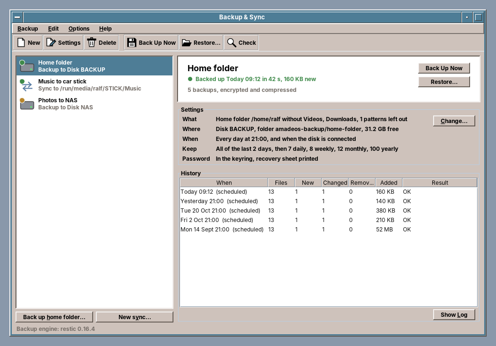
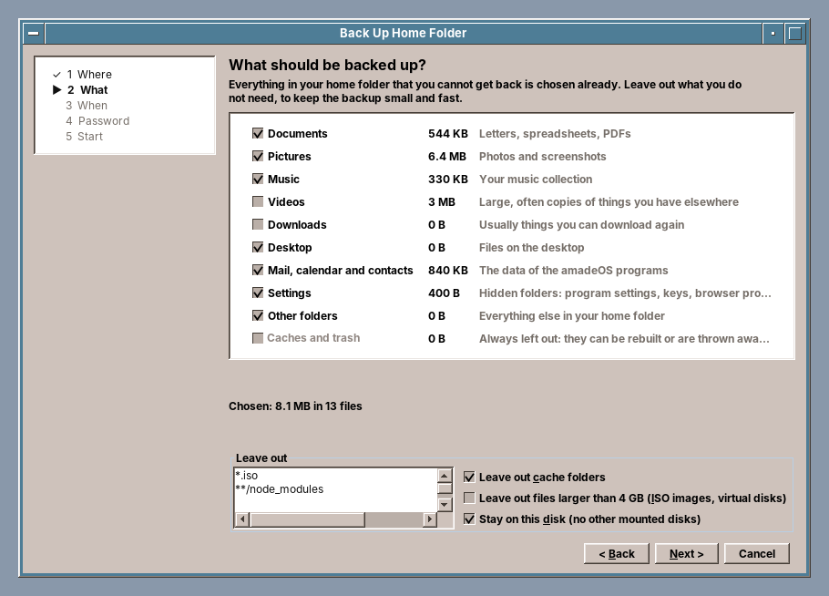
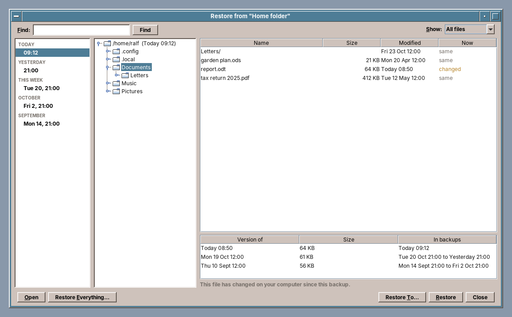
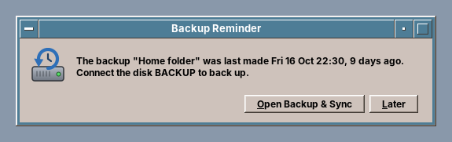

# amade-backup

**amade-backup** ("Backup & Sync") is the backup program of the [amadeOS](https://github.com/amadeos-eu/amadeos) desktop: versioned, encrypted backups of the home folder or any folders to an external disk, a restore window with a timeline, and folder syncs with a preview, for example music to the stick in the car. Built like the other amadeOS applications.




## Features

- **Back up the home folder** in five steps (*Back up home folder…*): where (an external disk, or another folder), what, when, password, start. The home folder is already sorted into areas with their sizes: Documents, Pictures, Music, Mail, calendar and contacts, Settings and Other folders are chosen; Videos and Downloads can be added; caches and the trash are always left out. Patterns such as `*.iso` or `**/node_modules` leave out more, and the backup stays on the home disk.

  
- **Versioned backups**: every run is a complete picture of the folders, and only what changed is stored again. Old versions are thinned out by a rule that reads as a sentence: *all of the last 2 days, then 7 daily, 8 weekly, 12 monthly, 100 yearly*.
- **Encrypted and compressed**. The password is kept in the keyring, so scheduled backups need no typing. A **recovery sheet** to print holds the password in large letters and how to get the files back. A `README-amadeOS-backup.txt` on the disk explains the folders and the restic commands, in the user's language and in English.
- **Disks are found by their UUID**, wherever they are mounted. A job whose disk is not connected says so ("Connect BACKUP to back up or restore") instead of failing.
- **Restore** (*Restore…*): a timeline of the backups (today, yesterday, this week, then by month), a folder tree, and the files with their state now (same, changed, deleted). Each file shows its versions and in which backups they are. *Show* filters for changed or deleted files, *Find* searches all backups. Files go back to their place or to another folder, and a file that is already there is never overwritten silently: it is replaced (the old one goes to the trash), kept next to it, or skipped; *Open* shows a version without restoring it.

  
- **Sync** folders one way, as an update (copy what is new or newer) or as a mirror (the target becomes a copy, files that are no longer in the source go to the trash, never deleted for good). Every sync starts with a **preview**: what is copied, updated, removed or left out, with the reason, the sizes and the free space. Nothing happens until *Sync Now*. Times and names are compared in a way that works on FAT and exFAT sticks.

  
- **Runs by itself**: a small helper starts with the session (`amade-backup --agent`, at low CPU and disk priority) and runs each job at its time, every day or once a week. A time missed because the computer was off or the disk not connected is made up as soon as the disk is there, and a job can also run whenever its disk is plugged in. A sync that only copies runs at once; one that would remove files shows its preview first. While restic works, the busy light of the Front Panel shows a violet chaser. Nothing starts on a nearly empty battery. After a backup, once a week, restic reads the backups back to check them. There is no message after a run that worked; a small window reminds when a backup is overdue and its disk has been away (once a day at most), and tells when a run failed.

  
- **History** of every job: when, how many files, new, changed, removed, added size, and the result; the log of a run is kept too. *Check* reads the backup and verifies it.
- **Several jobs**: backups of any folders, syncs with several folder pairs, each with its own schedule and keep rule.
- Five languages (English, Deutsch, Français, Español, Italiano), following the amadeOS desktop language.
- Theme colours and Motif look from [amade-commons](https://github.com/amadeos-eu/amade-commons).

## The backup engine

The backups are standard [restic](https://restic.net) repositories, in `amadeos-backup/<job>/` on the disk. They can be read with restic on any computer, even without amadeOS: `restic -r /media/<you>/BACKUP/amadeos-backup/home-folder mount /mnt`. The Debian package depends on `restic`.

The program only talks to the `BackupEngine` interface. restic does the work today; an engine of our own could replace it later without changing the windows, the jobs or the history.

## Platforms

Linux only for now (amadeOS and other Linux desktops); the release builds only the Debian package. restic itself runs on Windows too, but the program finds disks through `/proc/mounts` and `/dev/disk/by-uuid`, puts removed files into the freedesktop.org trash and keeps passwords in the Secret Service keyring. A Windows version would need drive letters with volume serial numbers, the Recycle Bin, the Credential Manager and an MSI that brings `restic.exe` along.

## Architecture

Java 25, Swing and Guice; start-up, theme and language come from `AmadeApplication` in amade-commons.

| Package | Contents |
|---|---|
| `bootstrap` | `AmadeBackupApplication`, `BackupModule` |
| `domain` | `Job` (backup or sync), `Target`, `Schedule`, `KeepPolicy`, `HomeArea` and `HomeLayout` (the areas of the home folder), `Snapshot`, `SnapshotEntry`, `Timeline`, `Comparison`, `RunRecord`, `RunResult` |
| `engine` | `BackupEngine`, `Repository`, `BackupRequest`; `engine.restic`: `ResticEngine` (the restic command line with `--json`, password on stdin) |
| `disk` | `Disks`: mounted disks with their UUID and label, from `/proc/mounts` and `/dev/disk/by-*` |
| `run` | `BackupRunner`, `Restorer`, `SyncRunner`, `Places` (where a target is now), `Passwords` (keyring), `Readme`, `JobLock` |
| `sync` | `SyncPlanner` (the preview), `SyncExecutor`, `Patterns`, `Trash` (freedesktop.org trash, also on other disks), `FileSystemInfo` |
| `repository` | `JobStore` (`~/.config/amadeos/backup/jobs.json`), `HistoryStore` (`~/.local/state/amadeos/backup/<job>/`) |
| `agent` | `BackupAgent` (the helper: what is due, reminders, the weekly check), `Planner` (when a job runs, without threads or disks), `AgentState` (`~/.local/state/amadeos/backup/agent.json`), `Power`, `AgentLauncher` (the window starts the helper), `AgentMain` |
| `ui` | `main` (window, presenter, menus), `assistant` (home folder backup), `restore`, `sync` (preview), `edit` (job editor), `notice` (the helper's reminders), `common` (progress, password, recovery sheet, formats) |

The windows know nothing of restic, and the runners know nothing of Swing: the presenter starts runs on a background thread and shows their progress, the helper on its own thread.

The helper is started at login by `/etc/amadeos/autostart.d/60-amade-backup` (on other desktops by `/etc/xdg/autostart/amade-backup-agent.desktop`) and can be switched off in Settings > Startup. It ends at once when no job runs by itself, and the window starts it again when a job gets a schedule. A lock in `~/.local/state/amadeos/backup/agent/` keeps it to one per user; its log is `~/.cache/amadeos/logs/backup-agent.log`. The window and the helper share the history, and the job locks keep a job from running twice.

## Build and run

```sh
./gradlew run                              # start
./gradlew run --args=--agent               # the helper, without a window
./gradlew test                             # Swing tests need a display: xvfb-run ./gradlew test; some tests need restic
./gradlew deb                              # build/distributions/amade-backup_<version>_all.deb
./gradlew installToAmadeOs                 # the .deb into ../amadeos/config/packages.chroot/ for the ISO build
xvfb-run ./gradlew screenshots             # the pictures in docs/screenshots, from the real windows
```

If `../amade-commons` is checked out next to this repository, Gradle builds against that checkout instead of the JitPack version.

## Planned

- A cell in the Front Panel with the state of the backups
- Backups to a network share or an SFTP server
- An engine of our own behind `BackupEngine`

## License

[EUPL-1.2](LICENSE)
